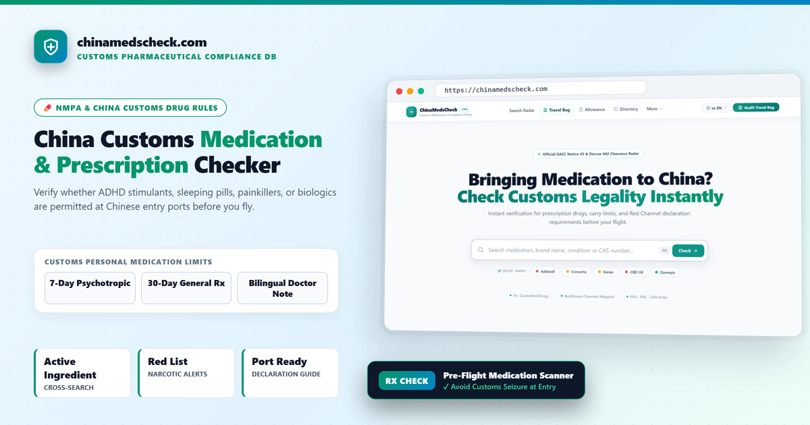
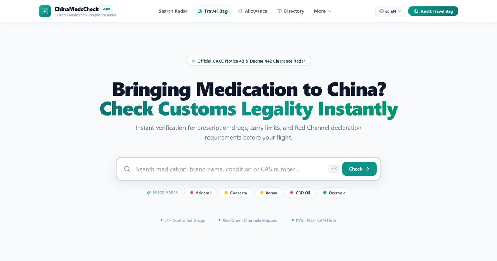
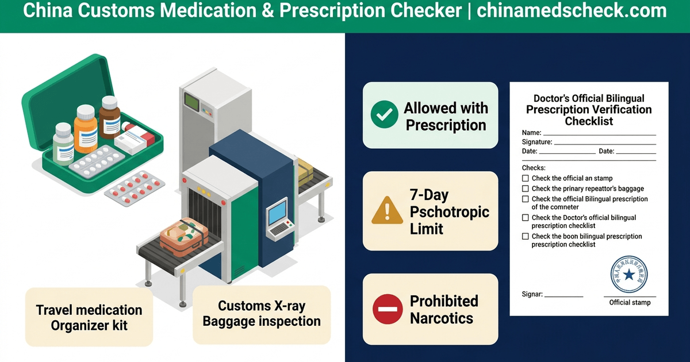

# ChinaMedsCheck MCP Server — China Customs GACC Medication Legality & Airport Red-Channel Engine



## Overview & Production Architecture

**ChinaMedsCheck** ([https://chinamedscheck.com](https://chinamedscheck.com)) exposes a stateless, zero-authentication **Model Context Protocol (MCP)** server (`streamable-http` at `https://chinamedscheck.com/api/mcp`) backed directly by a 38-drug **China Customs (GACC Decree 442)** compliance database, **CAAC aviation security** sharps and cold-chain carry-on rules, 4 flagship international airport **Red Channel** walkthroughs (`PVG, PEK, CAN, PKX`), bilingual Simplified Mandarin pharmacy/doctor show cards with Pinyin, multi-drug luggage manifest auditing, and therapeutic substitute similarity graphs. All 8 tools are public, deterministic, and annotated `readOnlyHint: true` with zero API keys required.



## Available MCP Tools (8 Read-Only Tools)

| Tool Name | Purpose & Deterministic Engine | Key Parameters | Safety |
| :--- | :--- | :--- | :---: |
| `screen_medication_gacc_customs_legality` | Match prescription brands, active ingredients, CAS numbers, RxNorm CUIs, Chinese names, or Russian/Japanese/Korean/Vietnamese aliases against 38  | `medicationQuery`*, `statusFilter` | `readOnly` |
| `calculate_medication_supply_allowance` | Compute whether carried medication quantities fall within legal Class I psychotropic (7-day), Class II (15-day), or maintenance prescription (90- | `medicationQuery`*, `carriedSupplyDays`*, `stayDurationDays` | `readOnly` |
| `evaluate_caac_cabin_sharps_and_cold_chain` | Inspect Civil Aviation Administration of China cabin rules for insulin pens, EpiPen auto-injectors, medical needles, refrigerated cold packs, and | `medicationQuery`, `filterMode` | `readOnly` |
| `generate_bilingual_china_pharmacy_card` | Produce printable simplified Mandarin doctor/pharmacist consultation notes, Pinyin pronunciation, domestic brand equivalents, and customs officer | `medicationQuery`*, `passengerName`, `daysOfSupply` | `readOnly` |
| `check_china_hospital_refill_and_clinic_pathway` | Determine if a foreign prescription can be legally re-prescribed inside Chinese Tier-3 hospitals or expat clinics, listing required department sp | `medicationQuery`* | `readOnly` |
| `audit_multi_medication_travel_bag_manifest` | Evaluate an entire packed toiletry or travel bag containing multiple medications simultaneously to pinpoint any single banned trigger, aggregate  | `bagItems`*, `stayDurationDays` | `readOnly` |
| `query_airport_red_channel_meds_walkthrough` | Look up customs pre-inspection CT lock procedures, exact Red Channel declaration counters, operating hours, and arrival baggage steps across PVG, | `airportQuery`*, `locale` | `readOnly` |
| `lookup_therapeutic_substitute_mesh` | Traverse the curated 38-drug therapeutic similarity graph to surface legal Chinese-approved substitutes and side-by-side risk comparisons when a  | `medicationQuery`* | `readOnly` |

## Live JSON-RPC 2.0 Verification Sample

Request (`POST https://chinamedscheck.com/api/mcp`):

```bash
curl -s -X POST https://chinamedscheck.com/api/mcp \
  -H "Content-Type: application/json" \
  -d '{"jsonrpc":"2.0","id":1,"method":"tools/call","params":{"name":"calculate_medication_supply_allowance","arguments":{"medicationQuery":"Concerta","carriedSupplyDays":7,"stayDurationDays":14}}}'
```

Verified Production Response:

```json
{
  "sourceEngine": "components/tools/AllowanceCalculatorWidget.tsx (GACC Decree 442)",
  "matchedMedication": {
    "slug": "ritalin-concerta-in-china",
    "brandNames": [
      "Ritalin",
      "Concerta",
      "Medikinet",
      "Daytrana",
      "Equasym"
    ],
    "genericName": "Methylphenidate",
    "chineseName": "哌甲酯 (利他林 / 专注达)",
    "status": "YELLOW",
    "officialUrl": "https://chinamedscheck.com/drugs/ritalin-concerta-in-china"
  },
  "classification": "CONTROLLED_CAT1",
  "verdict": "COMPLIANT",
  "recommendedChannel": "RED_CHANNEL",
  "statutoryMaxDays": 7,
  "carriedSupplyDays": 7,
  "stayDurationDays": 14,
  "compliant": true,
  "needsLocalRefill": true,
  "summary": "Within Class I Psychotropic 7-day cap; MUST declare at Customs Red Channel with stamped clinic prescription & diagnosis.",
  "localAlternative": "Prescriptions can be refilled in major Chinese cities (Beijing, Shanghai, Guangzhou, Shenzhen, Chengdu) by visiting the psychiatric outpatient department of a Tier-3 public hospital or an accredited international hospital (e.g., Jiahui Health, United Family Healthcare).",
  "calculatorUrl": "https://chinamedscheck.com/calculator"
}
```

## Quick Client Configuration (Claude Desktop / Cursor / Windsurf / Hermes)

```json
{
  "mcpServers": {
    "chinamedscheck": {
      "type": "streamable-http",
      "url": "https://chinamedscheck.com/api/mcp"
    }
  }
}
```

Or run directly from any Node.js terminal via the pinned official CLI:

```bash
npx -y chinamedscheck-cli@1.0.0 tools
npx -y chinamedscheck-cli@1.0.0 demo
```

## Statutory Compliance & Border Check Tables

### GACC Decree 442 Medication Border Classification Matrix

| Border Status | Statutory Substance Category | Maximum Carry-In Allowance | Mandatory Arrival Channel & Compliance Rule |
| :--- | :--- | :---: | :--- |
| **`RED` (Prohibited)** | Amphetamine (`Adderall`), THC / CBD oil, Oxycodone, Fentanyl | **`0 days` (Banned)** | **Strictly forbidden**: zero foreign prescription exemption (PRC Criminal Law Art. 347 & 357) |
| **`YELLOW` (Class I Psychotropic)** | Methylphenidate (`Concerta / Ritalin`), Modafinil | **`<= 7 days`** | **Mandatory Red Channel**: original pharmacy bottle + stamped clinic diagnosis |
| **`YELLOW` (Class II / Controlled)** | Alprazolam (`Xanax`), Zolpidem (`Ambien`), Diazepam | **`<= 15 days`** | **Mandatory Red Channel**: signed prescription + round-trip itinerary |
| **`GREEN` (Maintenance / OTC)** | Metformin, Ozempic, Ibuprofen, Loratadine | **`<= 90 days`** | **Green Channel**: personal-use dosage in original sealed blister/box |

### Airport Red Channel & Automated CT Pre-Screen Lock Walkthrough (`PVG, PEK, CAN, PKX`)

| Arrival Port | IATA | Customs Declaration Counter Location | Inspection Mechanism & Electronic Seal Rule |
| :--- | :---: | :--- | :--- |
| **Shanghai Pudong (T2)** | `PVG` | 1F Baggage Claim Exit Red Channel Desk | High-speed Pre-Arrival CT scan places yellow electronic lock on flagged luggage |
| **Beijing Capital (T3)** | `PEK` | T3-E Arrivals Hall Customs Declaration Desk | Dual baggage X-ray + physical prescription/hospital letter check |
| **Guangzhou Baiyun (T2)** | `CAN` | T2 International Arrivals Customs Desk | Strict cold-chain & pseudoephedrine screening for Southern entries |
| **Beijing Daxing** | `PKX` | 1F International Arrivals Customs Channel | Direct red/green channel segregation beside NIA biometric gates |

### CAAC Aviation Security & Local Hospital Substitute Reference

| Medication / Equipment | CAAC Cabin / Checked Rule | Legal In-China Refill Pathway |
| :--- | :--- | :--- |
| **Insulin Pens & Cold Chain** | Carry-on permitted with doctor certificate & medical cooling case | Tier-3 public hospitals & international clinics refill standard insulins |
| **ADHD (`Adderall` Blocked)** | Banned on all incoming PRC flights | Transition to `Concerta` (红处方 Class I) or non-stimulant `Strattera` (择思达) |
| **Benzodiazepines (`Xanax`)** | Carry in original labeled vial inside cabin carry-on | Hospital psychiatry/sleep clinic short-term prescription matching passport ID |

## Technical Architecture & Editorial Reference



## Official Web Tools & Medication Guides

- **[ChinaMedsCheck Official Portal — China Customs Controlled Medication Screener](https://chinamedscheck.com)** — `https://chinamedscheck.com`
- **[Full 38-Medication GACC Customs Legality Database (A–Z)](https://chinamedscheck.com/drugs)** — `https://chinamedscheck.com/drugs`
- **[GACC Decree 442 Supply Allowance & Red-Channel Calculator](https://chinamedscheck.com/calculator)** — `https://chinamedscheck.com/calculator`
- **[Bilingual China Customs Medication Declaration Card Generator](https://chinamedscheck.com/customs-card)** — `https://chinamedscheck.com/customs-card`
- **[Adderall (Amphetamine) in China Customs Rules & Legal Alternatives](https://chinamedscheck.com/drugs/adderall-in-china)** — `https://chinamedscheck.com/drugs/adderall-in-china`
- **[Ritalin & Concerta (Methylphenidate) 7-Day Cap & Red-Channel Guide](https://chinamedscheck.com/drugs/ritalin-concerta-in-china)** — `https://chinamedscheck.com/drugs/ritalin-concerta-in-china`
- **[Xanax (Alprazolam) Class II Psychotropic Carry-In Rules for China](https://chinamedscheck.com/drugs/xanax-in-china)** — `https://chinamedscheck.com/drugs/xanax-in-china`
- **[CBD Oil & Medical Cannabis Zero-Tolerance Prohibition in China](https://chinamedscheck.com/drugs/cbd-oil-in-china)** — `https://chinamedscheck.com/drugs/cbd-oil-in-china`
- **[Traveling with ADHD Medication in China: Complete Protocol](https://chinamedscheck.com/guide/adhd-medication-in-china)** — `https://chinamedscheck.com/guide/adhd-medication-in-china`
- **[China International Airport Customs Red Channel Clearance Walkthrough](https://chinamedscheck.com/guide/port-clearance-walkthrough)** — `https://chinamedscheck.com/guide/port-clearance-walkthrough`

## License

MIT License — maintained by **[ChinaMedsCheck](https://chinamedscheck.com)**.
